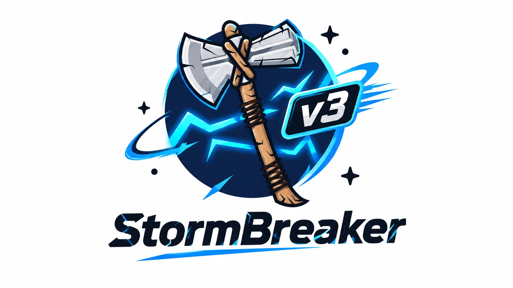
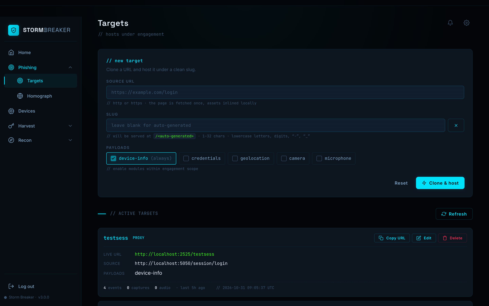
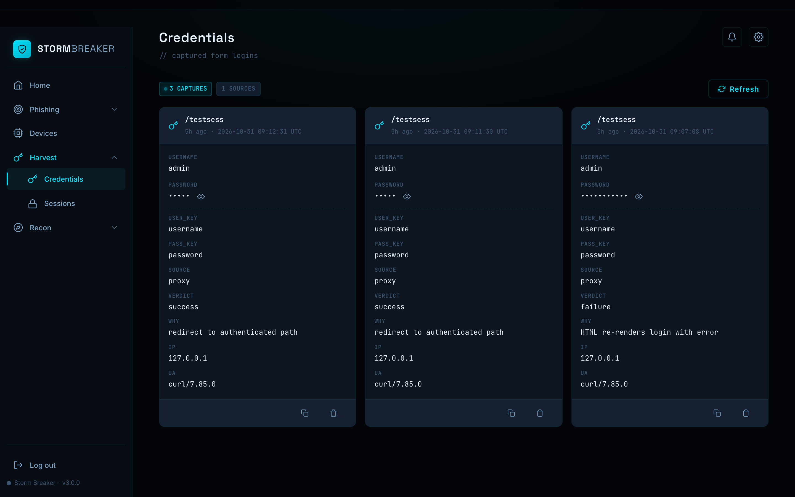
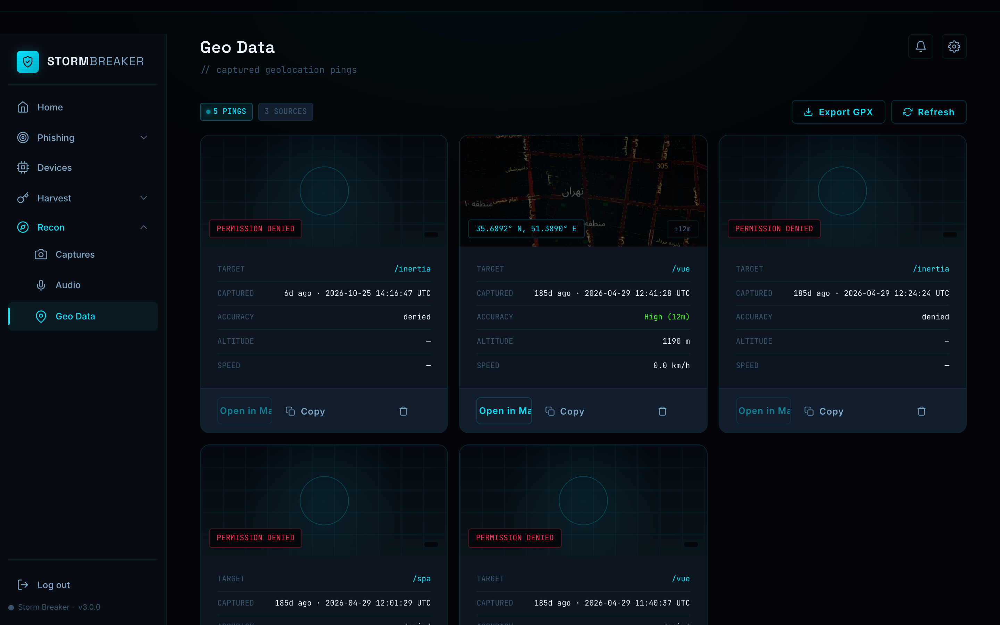

<p align="center">
  
</p>

<h1 align="center">Storm Breaker v3</h1>

<p align="center">
  <b>Advanced Phishing & Social Engineering Framework with MITM Proxy, Credential Harvesting, Session Hijacking, and Browser-Based Tracking.</b>
</p>

<p align="center">
  
  
  
  
</p>

---

## What is Storm Breaker?

Storm Breaker clones a target web page and injects capture modules (camera, microphone, geolocation, device-info, form credentials) that run in the visitor's browser, collecting data back to the operator's panel.

> **This is a lab tool for authorized security testing. Use responsibly and within legal boundaries.**

---

## Features

- **Page Cloning** — Headless Chrome rendering with cURL fallback; strips original scripts, injects payloads, resolves assets via `<base href>`
- **MITM Proxy** — transparent reverse proxy that relays requests to the real target, rewrites all URLs, and patches fetch/XHR/WebSocket/history so the entire session stays routed through the operator
- **Credential Sniffing** — smart extraction from POST bodies: form-urlencoded, multipart, JSON, GraphQL, Livewire RPC, Inertia.js, and nested structures
- **Credential Verification** — auto-detects login success or failure from HTTP status codes, redirects, JSON responses, and HTML re-renders
- **Session Hijacking** — snapshots the victim's cookie jar on verified login and exports Cookie-Editor JSON for instant session replay
- **Camera Capture** — periodic snapshots from the visitor's webcam with proper cleanup on revoke/pagehide
- **Microphone Recording** — audio clip capture from the visitor's mic
- **Geolocation Tracking** — GPS location pings with coordinates and accuracy
- **Device Fingerprinting** — browser, OS, screen, and hardware info (always on)
- **Custom JS Injection** — inject your own JavaScript into cloned pages; runs after all built-in payloads with access to the Storm Breaker runtime API
- **Homograph Domain Generator** — 9 confusion categories: Cyrillic, Armenian, Greek, mixed-script, diacritics, digit swap, bigram swap, edit distance, and TLD swap with RDAP availability check
- **Real-time SSE Stream** — Server-Sent Events push for live credential and session notifications

---

## Screenshots

### Targets — Clone & Host
<p align="center">
  
</p>

### Credentials — Captured Logins
<p align="center">
  
</p>

### Geo Data — Location Pings
<p align="center">
  
</p>

---

## Quick Start

```bash
git clone https://github.com/ultrasecurity/Storm-Breaker.git
cd Storm-Breaker
bash deploy.sh --local    # installs PHP + extensions (macOS & Linux)
php run-local.php
```

Open `http://localhost:2525` — default credentials: `admin` / `admin`.

**Requirements:** PHP 7.4+ with ext-sqlite3, ext-curl, ext-json, ext-session. Headless Chrome optional (enables full SPA cloning). The `--local` flag handles all of this automatically on macOS (Homebrew) and Linux (apt/dnf).

---

## Local Setup (`--local`)

The `--local` flag installs only the prerequisites needed to run Storm Breaker on your own machine — no nginx, systemd, TLS, or firewall configuration.

| Platform | Package Manager | Root Required? |
|----------|----------------|----------------|
| macOS | Homebrew | No |
| Debian / Ubuntu | apt | Yes |
| RHEL / CentOS / Fedora | dnf | Yes |

What it does:
- Installs PHP and required extensions (sqlite3, curl, json, session)
- Verifies PHP version is 7.4+
- Checks for headless Chrome (optional — needed for full SPA cloning)
- Prints a summary and the command to start the local server

```bash
bash deploy.sh --local       # macOS — no sudo needed
sudo bash deploy.sh --local  # Linux — needs root for package install
```

After setup, start the panel:

```bash
php run-local.php
# → http://localhost:2525
```

> **Note:** Local mode is for testing and development. For production use with HTTPS (required for camera/mic/geo), use the full server deployment below.

---

## Server Deployment

```bash
sudo bash deploy.sh
```

The setup wizard walks you through everything: server IP, HTTPS certificate, and admin credentials. It handles Debian/Ubuntu and RHEL/CentOS/Fedora automatically.

If you have a domain, the wizard can set up a **free HTTPS certificate** from Let's Encrypt — just have your domain and email ready.

> **HTTPS is required** — camera, microphone, and geolocation APIs only work in secure contexts.

<details>
<summary>Advanced: skip the wizard with flags</summary>

```bash
sudo bash deploy.sh --ip 1.2.3.4 --domain panel.example.com --email you@example.com
```

| Flag | Description |
|------|-------------|
| `--ip` | Server IP (auto-detected by default) |
| `--domain` | Domain for Let's Encrypt TLS |
| `--email` | Email for Let's Encrypt |
| `--php-port` | Internal PHP port (default: 9874) |
| `--user` | Service user (default: stormbreaker) |
| `--local` | Install prerequisites only (no server setup) |
| `--uninstall` | Remove service + nginx config |

</details>

---

## Usage

1. Go to **Targets** → enter a URL → select payloads → **Clone & host**
2. Send the generated `https://your-domain.com/<slug>` link to the target
3. View captured data in **Devices**, **Credentials**, **Captures**, **Audio**, **Geo Data**

---

## Security Notes

- **Change default credentials** — the deploy script prompts for this; do it.
- **`capture.php` is intentionally public** — it has slug validation, path-traversal guards, and size/rate caps.
- **`data/` is protected** — `router.php` blocks direct access; `.htaccess` as backup.
- **systemd hardening** — `NoNewPrivileges`, `PrivateTmp`, `ProtectSystem=full`, `UMask=0077`.

---

## Migrating from v2

```bash
php storm-web/tools/migrate-to-sqlite.php
```

Imports `result.txt`, `meta.json`, `captures/`, and `audio/` from each target into SQLite. Safe to re-run.

---

## License

MIT License — see [LICENSE](LICENSE) for details.
