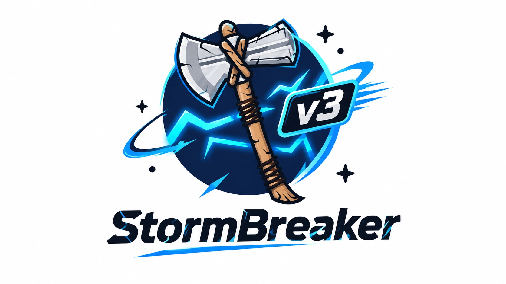
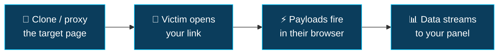
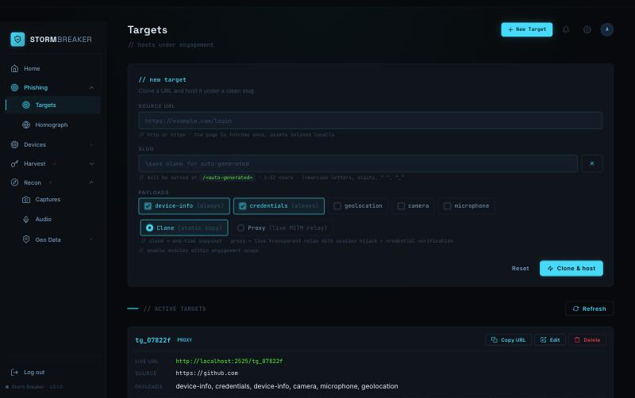
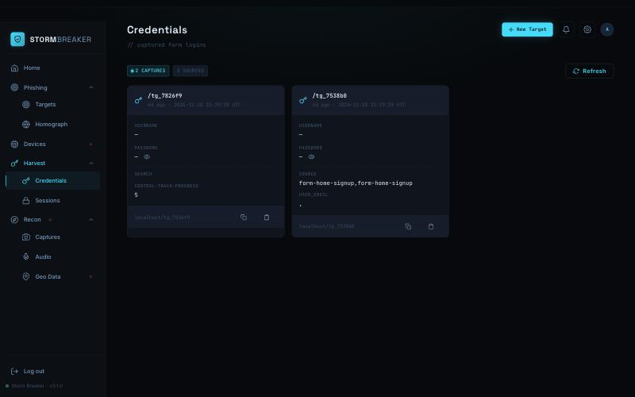
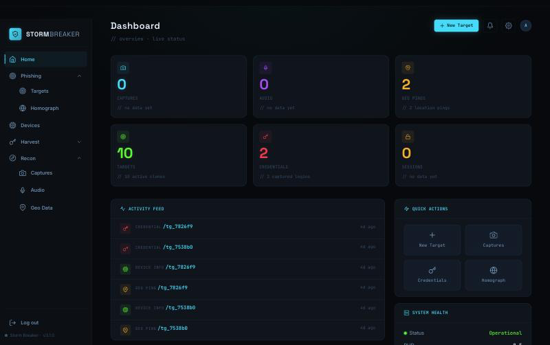

<p align="center">
  
</p>

<h1 align="center">Storm Breaker</h1>

<p align="center">
  <b>Phishing &amp; social-engineering framework — clone any page, inject capture payloads, harvest credentials and sessions from one live panel.</b>
</p>

<p align="center">
  <a href="https://github.com/ultrasecurity/Storm-Breaker/stargazers"></a>
  <a href="https://github.com/ultrasecurity/Storm-Breaker/network/members"></a>
  
  
  
</p>

<p align="center">
  <sub>For authorized security testing and research only. Use within legal boundaries.</sub>
</p>

---

## How It Works



Storm Breaker renders a copy of the target page, swaps in capture modules that run client-side, and relays everything the visitor's browser gives up back to a real-time operator dashboard.

---

## Features

| | | | |
|---|---|---|---|
| 🧬 **Page Cloning** | Headless Chrome render with cURL fallback | 🔀 **MITM Proxy** | Transparent reverse proxy, full URL &amp; fetch/XHR rewrite |
| 🔑 **Credential Sniffing** | Extracts from form, JSON, GraphQL, Livewire, Inertia | ✅ **Login Verification** | Auto-detects success from status, redirect &amp; body |
| 🍪 **Session Hijacking** | Exports Cookie-Editor JSON for instant replay | 📷 **Camera Capture** | Periodic webcam snapshots with clean revoke handling |
| 🎙️ **Mic Recording** | Grabs audio clips from the visitor's microphone | 📍 **Geolocation** | GPS pings with coordinates and accuracy |
| 🖥️ **Device Fingerprint** | Browser, OS, screen &amp; hardware (always on) | 🧩 **Custom JS** | Inject your own scripts over the runtime API |
| 🌐 **Homograph Generator** | 9 confusion sets + RDAP availability check | 📡 **Live SSE Stream** | Server-Sent push for credential &amp; session alerts |

---

## Screenshots

| Targets | Credentials | Dashboard |
|:---:|:---:|:---:|
|  |  |  |
| Clone &amp; host a page | Captured logins | Live operator panel |

---

## Quick Start

```bash
git clone https://github.com/ultrasecurity/Storm-Breaker.git
cd Storm-Breaker
bash deploy.sh --local    # installs PHP + extensions (macOS & Linux)
php run-local.php          # → http://localhost:2525  (admin / admin)
```

<details>
<summary><b>Local setup details</b></summary>

<br>

`--local` installs only what's needed to run on your own machine — no nginx, systemd, or TLS.

| Platform | Package Manager | Root |
|----------|-----------------|------|
| macOS | Homebrew | No |
| Debian / Ubuntu | apt | Yes |
| RHEL / Fedora | dnf | Yes |

**Requirements:** PHP 7.4+ with `ext-sqlite3`, `ext-curl`, `ext-json`, `ext-session`, `ext-mbstring`, `ext-dom`, `ext-xml`. Headless Chrome is optional and unlocks full SPA cloning. Local mode is for testing — camera, mic, and geo need HTTPS, so use a server deployment for live work.

</details>

<details>
<summary><b>Server deployment (HTTPS)</b></summary>

<br>

```bash
sudo bash deploy.sh
```

The wizard walks through server IP, admin credentials, and a free Let's Encrypt certificate (have your domain and email ready). **HTTPS is required** — camera, mic, and geolocation only work in a secure context.

```bash
# skip the wizard with flags
sudo bash deploy.sh --ip 1.2.3.4 --domain panel.example.com --email you@example.com
```

| Flag | Description |
|------|-------------|
| `--ip` | Server IP (auto-detected) |
| `--domain` | Domain for Let's Encrypt TLS |
| `--email` | Email for Let's Encrypt |
| `--php-port` | Internal PHP port (default 9874) |
| `--user` | Service user (default stormbreaker) |
| `--uninstall` | Remove service + nginx config |

</details>

---

## Usage

**1.** Open **Targets**, enter a URL, pick payloads, and hit **Clone &amp; host**. &nbsp;→&nbsp; **2.** Send the generated link to your target. &nbsp;→&nbsp; **3.** Watch captures land under **Devices**, **Credentials**, **Captures**, **Audio**, and **Geo Data**.

<details>
<summary><b>Security notes &amp; migrating from v2</b></summary>

<br>

- **Change the default credentials** — the deploy script prompts for this.
- `capture.php` is intentionally public, guarded by slug validation, path-traversal checks, and size/rate caps.
- `data/` is protected by `router.php` (with `.htaccess` as backup).
- systemd hardening: `NoNewPrivileges`, `PrivateTmp`, `ProtectSystem=full`, `UMask=0077`.

Migrating a v2 install:

```bash
php storm-web/tools/migrate-to-sqlite.php   # imports result.txt, meta.json, captures/, audio/ — safe to re-run
```

</details>

---

<p align="center">
  
</p>

<p align="center">
  
</p>

<p align="center">
  <sub>Released under the <a href="LICENSE">MIT License</a>.</sub>
</p>
