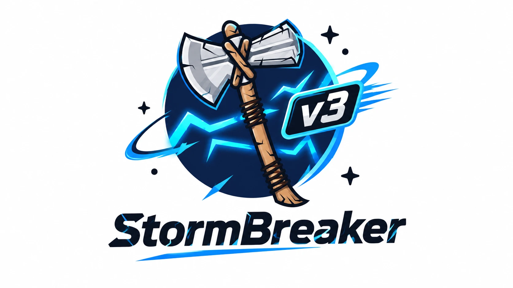
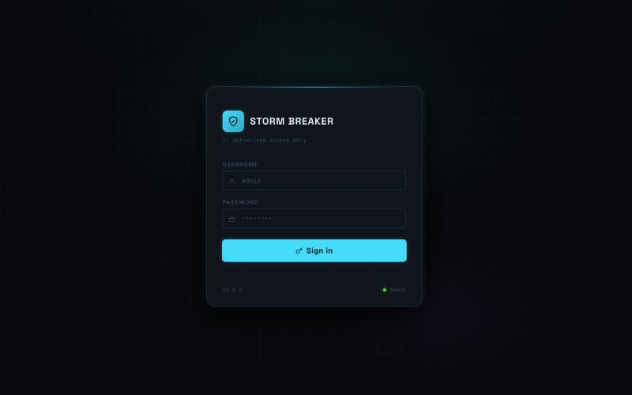
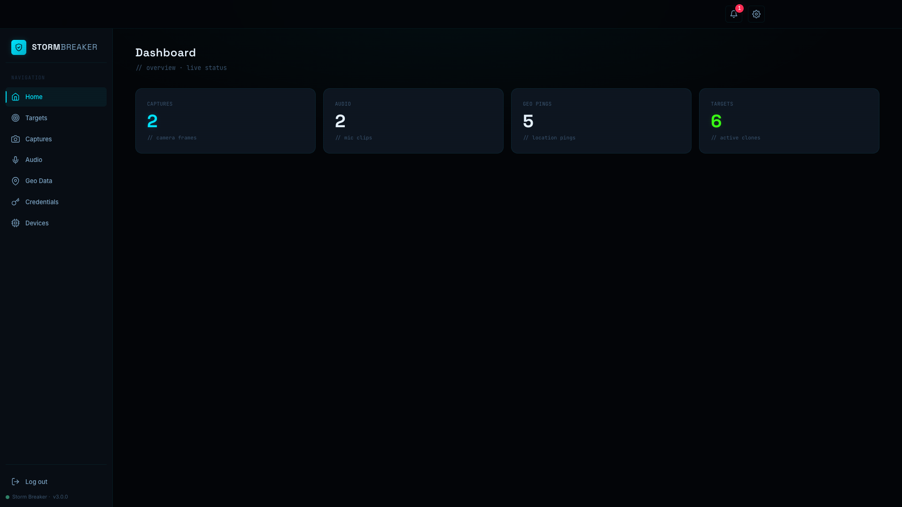
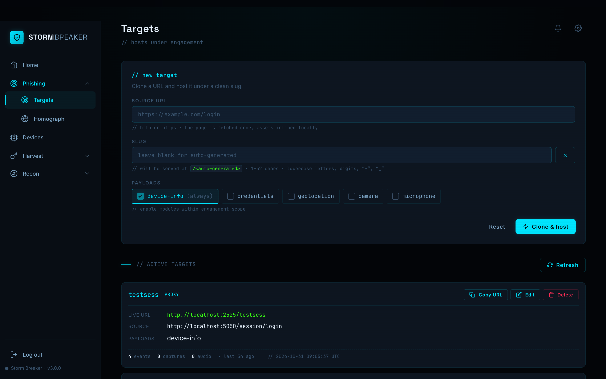
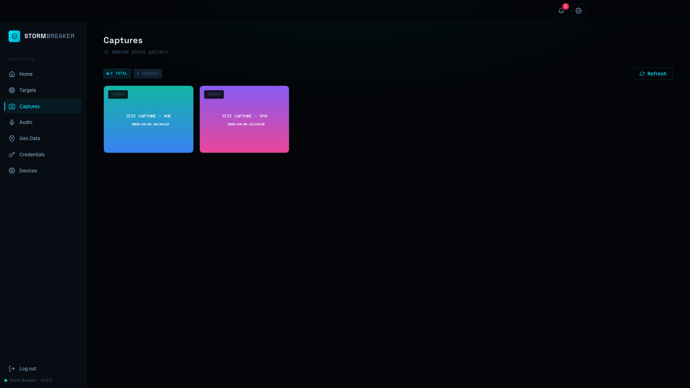
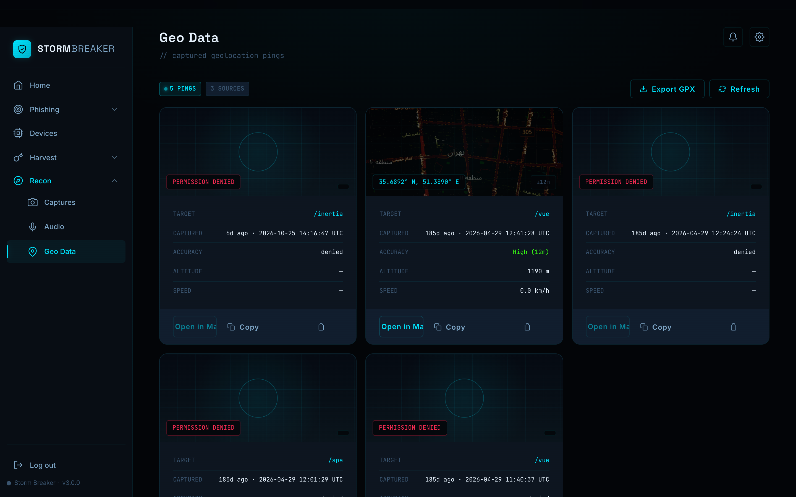
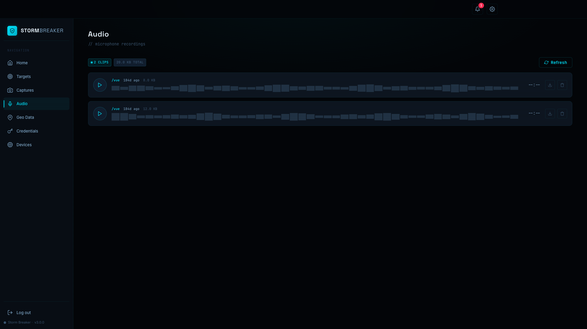
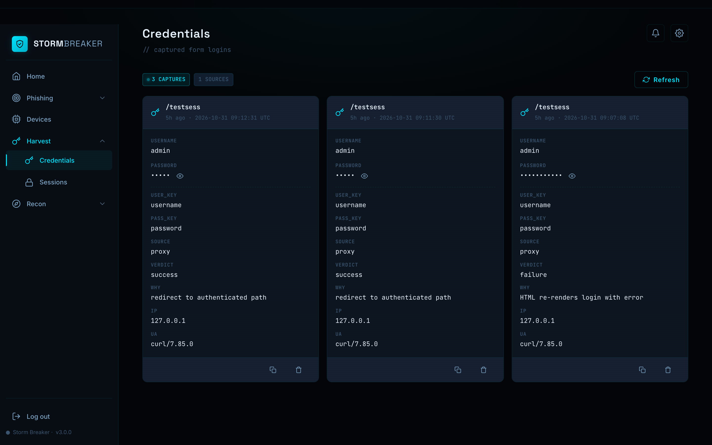
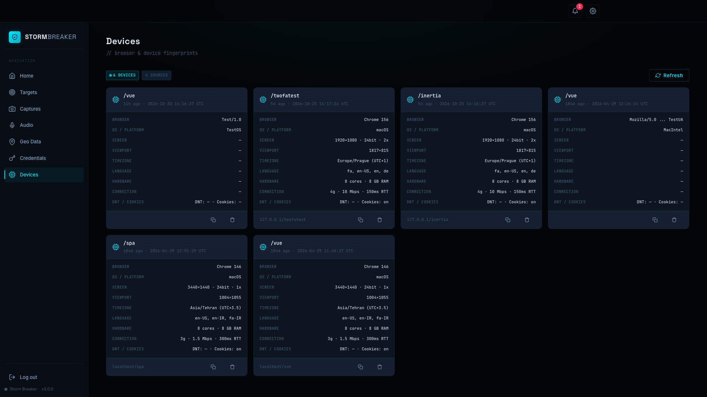

<p align="center">
  
</p>

<h1 align="center">Storm Breaker v3</h1>

<p align="center">
  <b>Open-source browser security assessment tool for red teams</b>
</p>

<p align="center">
  
  
  
  
</p>

---

## What is Storm Breaker?

Storm Breaker is an open-source red-team tool for browser security assessment. It clones a target web page and injects capture modules (camera, microphone, geolocation, device-info, form credentials) that run in the visitor's browser, collecting data back to the operator's panel.

> **This is a lab tool for authorized security testing. Use responsibly and within legal boundaries.**

---

## Screenshots

### Login
<p align="center">
  
</p>

### Dashboard
<p align="center">
  
</p>

### Targets — Clone & Host
<p align="center">
  
</p>

### Captures — Camera Frames
<p align="center">
  
</p>

### Geo Data — Location Pings
<p align="center">
  
</p>

### Audio — Mic Clips
<p align="center">
  
</p>

### Credentials
<p align="center">
  
</p>

### Devices
<p align="center">
  
</p>

---

## What's New in v3.0.0

### Complete PHP Rewrite
The entire codebase has been rewritten from scratch in modern PHP:

- **SQLite database** — flat-file storage (`result.txt`, `meta.json`) replaced with a proper SQLite3 database (`data/storm.db`). WAL journal mode, foreign keys, cascade deletes.
- **Modern auth system** — bcrypt password hashing with session hardening and automatic legacy-plaintext upgrade.
- **Real-time notification system** — server-polled notification dropdown with unread count, badge, and mark-all-read.
- **Auto-update system** — checks GitHub for new versions, shows a modal with version diff, and can self-update with backup + rollback.
- **New panel UI** — dark theme with a design system (custom properties, tokens, responsive layout), sidebar navigation, stat cards, and modals.

### Capture Improvements
- **Camera** — fixed snapshot interval leak (kept POSTing after camera revoked); proper cleanup on track `ended` / `pagehide`.
- **Credentials** — coalesced `MutationObserver` bursts into one hook pass per frame.
- **Per-target storage caps** — `CAPTURE_MAX_FRAMES`, `CAPTURE_MAX_CLIPS`, `CAPTURE_MAX_LOG_BYTES` → 429 when exceeded.

### Clone Engine
- Headless Chrome (`--dump-dom`) for full SPA rendering; falls back to cURL.
- Strips all original `<script>` tags after render, injects payload block.
- `<base href>` injection so un-downloaded assets still resolve.
- Fixed stray `<?xml>` processing instruction left by UTF-8 parse.

---

## Requirements

| Dependency | Required | Notes |
|------------|----------|-------|
| **PHP** | 7.4+ | Core runtime |
| **ext-sqlite3** | Yes | Database storage |
| **ext-curl** | Yes | Clone engine + update checker |
| **ext-json** | Yes | API endpoints |
| **ext-session** | Yes | Authentication |
| **Headless Chrome** | Optional | Full SPA rendering; falls back to cURL without it |

---

## Installation

### Quick Start (local testing)

> **Prerequisite:** PHP 7.4+ must be installed on your system. See [Installing PHP](#installing-php) below if you don't have it.

```bash
git clone https://github.com/ultrasecurity/Storm-Breaker.git
cd Storm-Breaker
php run-local.php
```

Open `http://localhost:2525` — default credentials: `admin` / `admin`.

### Server Deployment

```bash
git clone https://github.com/ultrasecurity/Storm-Breaker.git
cd Storm-Breaker
chmod +x deploy.sh
./deploy.sh
```

The deploy script will:

1. **Check PHP version** (7.4+ required)
2. **Verify extensions** (json, session, sqlite3, curl)
3. **Check for headless Chrome** (optional, warns if missing)
4. **Create directories** (`data/`, `targets/`, `log/`) with proper permissions
5. **Set up credentials** — if default `admin/admin` is detected, interactively prompts for a new username and password

Then point your web server's document root at `storm-web/`:

```nginx
# Nginx example
server {
    listen 443 ssl;
    server_name your-domain.com;

    root /path/to/Storm-Breaker/storm-web;
    index index.php;

    location / {
        try_files $uri $uri/ /router.php?$query_string;
    }

    location ~ \.php$ {
        fastcgi_pass unix:/run/php/php-fpm.sock;
        fastcgi_param SCRIPT_FILENAME $document_root$fastcgi_script_name;
        include fastcgi_params;
    }

    # Block direct access to data
    location ~ ^/(data|log)/ {
        deny all;
    }
}
```

```apache
# Apache — .htaccess (included in storm-web/)
RewriteEngine On
RewriteCond %{REQUEST_FILENAME} !-f
RewriteCond %{REQUEST_FILENAME} !-d
RewriteRule ^(.*)$ router.php [QSA,L]
```

> **HTTPS is required** — camera, microphone, and geolocation APIs only work in secure contexts.

### Installing Headless Chrome (optional)

```bash
# Debian/Ubuntu
sudo apt install chromium-browser
# or
sudo apt install google-chrome-stable

# CentOS/RHEL
sudo yum install chromium

# macOS
brew install --cask google-chrome
```

### Installing PHP

<details>
<summary><b>macOS</b></summary>

```bash
brew install php
```
</details>

<details>
<summary><b>Debian / Ubuntu</b></summary>

```bash
sudo apt update
sudo apt install php php-cli php-sqlite3 php-curl php-json
```
</details>

<details>
<summary><b>Fedora / RHEL / CentOS</b></summary>

```bash
sudo dnf install php php-cli php-pdo php-sqlite3 php-curl php-json
```
</details>

<details>
<summary><b>Arch Linux</b></summary>

```bash
sudo pacman -S php
```
</details>

---

## How It Works

```
Operator                        Visitor
   │                               │
   ├── Login to panel              │
   ├── Enter target URL            │
   ├── Select payloads             │
   ├── "Clone & host"              │
   │    ├── Headless Chrome render  │
   │    ├── Strip original scripts  │
   │    └── Inject capture modules  │
   │                               │
   │    /<slug> ───────────────────>│
   │                               ├── Page loads in browser
   │                               ├── Payloads run (camera/mic/geo/...)
   │                               └── Data POSTed to /api/capture.php
   │                               │
   ├── Dashboard shows live stats  │
   ├── View captures, audio, geo…  │
   └── Real-time notifications     │
```

---

## Project Structure

```
Storm-Breaker/
├── run-local.php              # Dev server launcher (localhost:2525)
├── deploy.sh                  # Server deployment helper
├── Settings.json              # Version metadata (semver)
│
└── storm-web/                 # Web root
    ├── router.php             # Front controller (slug routing + security)
    ├── index.php              # Entry point → panel or login
    ├── auth.php               # Auth: bcrypt, session hardening
    ├── config.php             # Credentials store (managed by auth.php)
    ├── panel.php              # Operator panel (single-page, routed)
    ├── login.php              # Login page
    ├── Settings.json          # Version metadata
    │
    ├── api/
    │   ├── capture.php        # PUBLIC ingestion endpoint (no auth)
    │   ├── targets.php        # Clone CRUD (auth-required)
    │   ├── captures.php       # Camera frame browser
    │   ├── audio.php          # Audio clip browser
    │   ├── geo.php            # Geolocation data
    │   ├── credentials.php    # Captured credentials
    │   ├── devices.php        # Device info
    │   ├── notifications.php  # Real-time notification feed
    │   └── update.php         # Auto-update from GitHub
    │
    ├── lib/
    │   ├── cloner.php         # Clone engine (Chrome/cURL + inject)
    │   └── store.php          # SQLite storage layer
    │
    ├── data/
    │   └── storm.db           # SQLite database (auto-created)
    │
    ├── assets/
    │   ├── payloads/          # Capture modules
    │   │   ├── consent.js     # Consent gate (optional)
    │   │   ├── camera.js      # Camera capture (gated)
    │   │   ├── microphone.js  # Mic recording (gated)
    │   │   ├── geolocation.js # Location tracking (gated)
    │   │   ├── device-info.js # Device fingerprint (gated)
    │   │   └── credentials.js # Form credential capture (gated)
    │   ├── components/        # Panel UI partials
    │   ├── css/               # Design system + panel styles
    │   └── js/                # Panel helpers + vendor libs
    │
    ├── targets/               # Generated clones (output, not source)
    ├── log/                   # Notification state
    └── tools/
        ├── migrate-to-sqlite.php  # Flat-file → SQLite migration
        └── rerender-targets.php   # Re-inject payload into old clones
```

---

## Usage

### Creating a Target

1. Go to **Targets** in the panel
2. Enter the **Source URL** (the page to clone)
3. Optionally set a custom **slug** (or leave blank for auto-generated)
4. Select **payloads** to inject:
   - `credentials` — always enabled (intercepts form submissions)
   - `device-info` — browser/OS fingerprint
   - `geolocation` — GPS location tracking
   - `camera` — camera snapshot capture
   - `microphone` — audio recording
5. Click **Clone & host**

The cloned page is now live at `https://your-domain.com/<slug>`.

### Viewing Captured Data

- **Dashboard** — overview stats (total captures, audio clips, geo pings, active targets)
- **Captures** — browse camera frames per target
- **Audio** — play back recorded mic clips
- **Geo Data** — view location pings on a map with coordinates + accuracy
- **Credentials** — see captured form submissions
- **Devices** — browser fingerprints and device info

### Auto-Update

Click the version number in the sidebar footer to check for updates. If a new version is available, a modal shows the version diff and an **Apply Update** button. The updater:

- Downloads the latest ZIP from GitHub
- Backs up current files (excluding `config.php`, `data/`, `targets/`, `log/`)
- Copies new files over
- Shows the result with file count and backup location

---

## Security Notes

- **Change default credentials** — the deploy script prompts for this; do it.
- **Use HTTPS** — camera/mic/geo APIs require a secure context.
- **`capture.php` is intentionally public** — visitor browsers POST data to it. It has slug validation, path-traversal guards, and size/rate caps.
- **`data/` is protected** — `router.php` blocks direct access; `.htaccess` as backup.
- **Session hardening** — `httponly`, `samesite=Strict`, secure flags, regeneration on login.

---

## Migrating from v2

If you have an existing Storm-Breaker v2 installation with flat-file data:

```bash
cd Storm-Breaker
php storm-web/tools/migrate-to-sqlite.php
```

This reads `result.txt`, `meta.json`, `captures/`, and `audio/` from each target directory and imports them into the SQLite database. Safe to re-run.

---

## Development

```bash
# Start the dev server
php run-local.php                 # localhost:2525

# Lint
php -l storm-web/<file>.php       # PHP syntax check
node --check storm-web/assets/payloads/<file>.js   # JS syntax check

# Rebuild knowledge graph (after large changes)
graphify . --update
```

---

## License

MIT License — see [LICENSE](LICENSE) for details.

